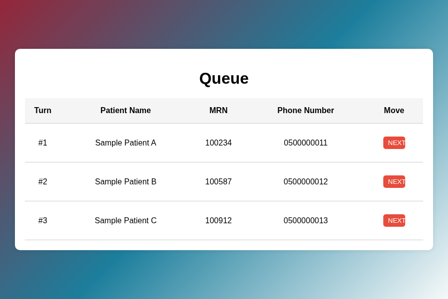
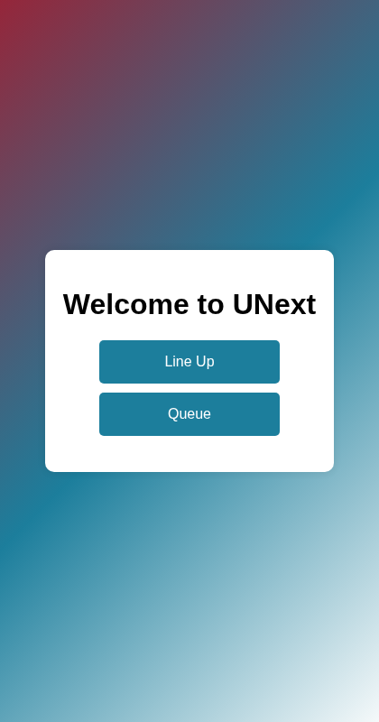
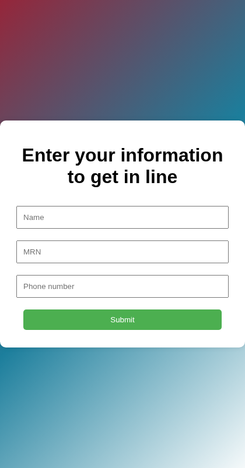
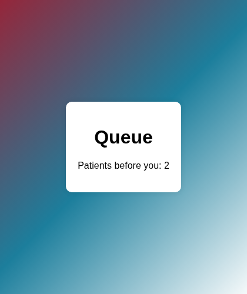

# UNext – Patient Queue System

> A mobile-friendly web queue for clinics. Patients scan a QR code to join the line and watch their position, and staff reorder and call patients from a drag-and-drop queue.



## Overview

**UNext** is a queuing-system prototype built during my summer training at **Medical Fakeeh** (June–August 2024). The aim was to manage patient flow in the medical facility and improve the waiting experience.

It is a static HTML/CSS/JavaScript app. Queue data is stored in the browser's `localStorage`.

## Features

- **QR code entry:** the home page generates a QR code for the *Line Up* or *Queue* page (via [qrcode.js](https://github.com/davidshimjs/qrcodejs)).
- **Line up:** patients enter their name, MRN and phone number. The form checks that the MRN is numeric and the phone number has 10 digits, and it rejects duplicate MRNs and phone numbers.
- **Queue status:** after joining, the patient sees how many people are ahead of them. The count updates when the queue changes (`storage` event).
- **Staff queue:** a table of waiting patients that staff can **drag and drop** to reorder ([SortableJS](https://sortablejs.github.io/Sortable/)), with a **NEXT** button to call and remove a patient.
- Responsive layout for phones and desktop

## Screenshots

| Home | Line up | Queue status |
|---|---|---|
|  |  |  |


*(The screenshots use sample, fictional patient data.)*

## Tech Stack

- HTML5, CSS3 (responsive media queries)
- Vanilla JavaScript + `localStorage`
- [qrcode.js](https://cdnjs.com/libraries/qrcodejs) and [SortableJS](https://sortablejs.github.io/Sortable/) via CDN

## How to Run

Serve the folder so that QR codes point to a real URL:

```bash
python3 -m http.server 8000
# open http://localhost:8000 (or http://<your-LAN-IP>:8000 to scan from a phone)
```

Opening `index.html` directly works for the pages themselves, but the QR codes will contain `file://` links.

> Because data is in `localStorage`, the patient view and the staff view share a queue only in the same browser. A real deployment would need a backend.

## Project Structure

```
UNext/
├── index.html     # home + QR code generator
├── lineUp.html    # patient registration form
├── Unext.html     # patient's queue position
├── queue.html     # staff queue (drag & drop, NEXT)
├── styles.css
└── docs/screenshots/
```

## Credits

Built by **Hala Jalal** during the Computer Science summer training (Umm Al-Qura University) at Medical Fakeeh, 2024.

## License

[MIT](LICENSE) © 2025 Hala Jalal
